# Windows Island

[English](README.md) | [Português (Brasil)](README.pt-BR.md) | **Español** | [Русский](README.ru.md)

Una Dynamic Island para Windows. La música, Claude Code, sus límites de uso y tus notificaciones viven en una pequeña píldora en la parte superior de la pantalla, con el aspecto del iPhone y animaciones de resorte.

<p align="center">
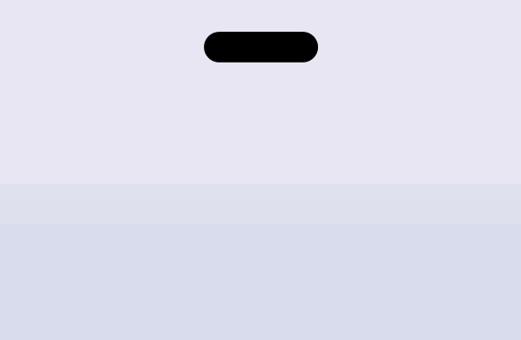
</p>

<p align="center">
<a href="https://github.com/leotrvs/windows-island/releases/latest/download/WindowsIsland.exe"></a>
</p>

> Proyecto no oficial de la comunidad. No está afiliado, respaldado ni mantenido por Apple, Anthropic ni OpenAI. "Claude" y el logo de Claude pertenecen a Anthropic, y "Codex" a OpenAI; la licencia MIT no los cubre.

## Funciones

- **Música** de cualquier reproductor que aparezca en los controles multimedia de Windows, como Spotify o un navegador: carátula, un ecualizador con el color de la carátula, una barra de progreso en la que puedes hacer clic para avanzar, y reproducir, pausar, siguiente y anterior
- **Actividad en vivo de Claude Code:** el símbolo de Claude "piensa" mientras Claude trabaja, con el tiempo transcurrido, y late cuando te está esperando
- **Uso de Claude:** anillos para los límites de **5 horas** y **semanal**, con la hora en que se renuevan
- **Codex:** una actividad en vivo mientras Codex trabaja, sus límites de 5 horas y semanal, y un aviso cuando termina
- **Páginas:** con la isla expandida, desplaza la rueda sobre ella o haz clic en los puntos para cambiar entre música, Claude y temporizador, que también tiene sus botones allí
- **Temporizador y cronómetro:** inícialos desde el menú de la bandeja; aparecen como actividad en vivo y avisan cuando se acaba el tiempo
- **Puntos de micrófono y cámara:** naranja con el micrófono en uso, verde con la cámara, como en el iPhone
- **Batería** en portátiles: aparece como actividad al cargar, además de avisos de cargador conectado o retirado, batería baja y carga completa
- **Nombres de las apps en los puntos:** mira qué app usa el micrófono o la cámara al pasar el ratón por la isla
- **Punto de pantalla compartida:** un punto azul mientras una app comparte o graba la pantalla, como en una llamada o una grabación
- **Discord silenciado o ensordecido (experimental, desactivado por defecto):** un micrófono tachado o unos auriculares tachados junto a la isla mientras estás silenciado en Discord, lo hayas hecho como lo hayas hecho. Necesita una app tuya en Discord, mira [docs/DISCORD.md](docs/DISCORD.md)
- **Ajustes claros u oscuros:** la ventana de Ajustes puede seguir el tema de Windows o quedarse en claro u oscuro; la isla siempre es negra
- **Tu orden y tus tiempos:** elige el orden de las páginas, qué avisos de límite mostrar (75%, 90%, 100%, renovado) y cuánto duran los avisos, las notificaciones y los avisos de límite
- **Barra de volumen y brillo**, avisos de **Bluetooth, USB y red** y una luna para **No molestar**
- **Página de reloj y sistema** con la hora, la fecha, la carga del procesador y de la memoria
- **Monitor del sistema** (desactivado por defecto): mantiene la carga del procesador y de la memoria en la isla cuando no pasa nada más, en anillos, barras o números
- **Guardar:** arrastra la isla hacia arriba para guardarla y usar lo que hay detrás; vuelve con una actividad nueva o cuando el ratón se queda quieto en su sitio
- **API local y línea de comandos** (desactivadas por defecto) para que tus scripts y apps muestren sus propias actividades y avisos, mira [docs/API.md](docs/API.md), y una pequeña [extensión de navegador](extension/README.md) que da al audio web el icono del sitio
- **Atajo de teclado** para abrir y cerrar la isla (desactivado por defecto, configurable)
- **Avisos** cuando Claude termina una tarea o te necesita
- **Avisos de límite:** un aviso cuando el límite de Claude de 5 horas o el semanal llega al 75%, 90% y 100%, y cuando se renueva
- **Notificaciones de Windows** en la isla, con el icono de la app que las envió, si las activas
- **Dos actividades a la vez:** la segunda se separa en una burbuja junto a la isla
- **Varios chats de Claude a la vez:** la isla los cuenta (por ejemplo `2 · 0:58`, o `1/2 · Esperando` cuando uno de dos te espera) y la página de Claude lista cada chat con su estado y tiempo
- **Permisos en Claude Desktop:** un chat de la app de escritorio de Claude que pide un permiso o hace una pregunta aparece como esperándote, igual que en el terminal La pregunta (si es corta) aparece en el aviso, con un enlace **Abrir Claude** en la página de Claude que trae la app al frente para responder.
- **Responder permisos en la isla (experimental, desactivado por defecto):** cuando Claude Code va a pedir un permiso, como leer una base de datos o aplicar una migración, la isla muestra la herramienta y lo que quiere hacer con **Permitir** y **Denegar**. Usa un gancho que activas en Ajustes; si no haces clic a tiempo, Claude pregunta como siempre
- **Iconos de sitios:** con la extensión del navegador, el audio web muestra el icono del propio sitio, y las notificaciones de sitios muestran el icono y el nombre del sitio
- **Movimiento fluido:** la forma y el contenido cambian con resortes, nunca con transiciones de duración fija
- **Discreta:** nunca toma el foco, los clics a su alrededor llegan a la ventana de abajo, se reduce a una línea fina cuando hay una ventana maximizada delante y se oculta en pantalla completa
- **Ligera:** unos 40 MB de memoria y menos del 1% de CPU con música sonando
- Se instala solo para tu usuario, con accesos directos en el menú Inicio y el Escritorio e inicio con Windows
- Inglés y portugués de Brasil
- Actualizaciones automáticas firmadas
- **Nunca lee tu inicio de sesión ni tu token de Claude**. Sus únicas conexiones son buscar actualizaciones en este repositorio y, si usas la extensión del navegador, la descarga de un icono pequeño por sitio

## Estados

| Estado | Aspecto |
|---|---|
| En reposo |  |
| Música sonando, con Claude trabajando al lado |  |
| Claude trabajando, con el tiempo transcurrido | 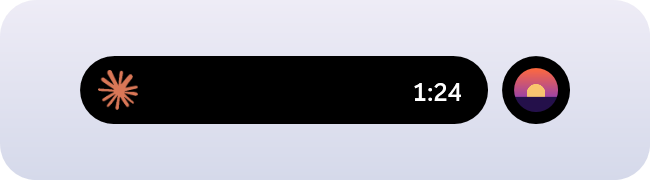 |
| Codex trabajando | 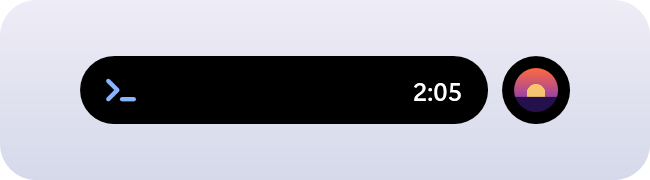 |
| Claude terminó o te necesita | 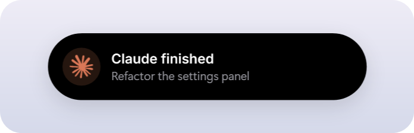 |
| Una notificación de Windows | 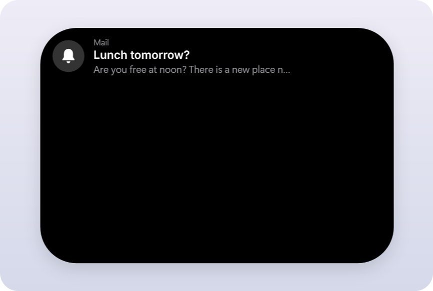 |
| Batería cargando |  |
| Batería baja | 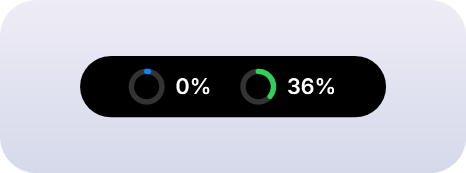 |
| Claude expandido, con los límites | 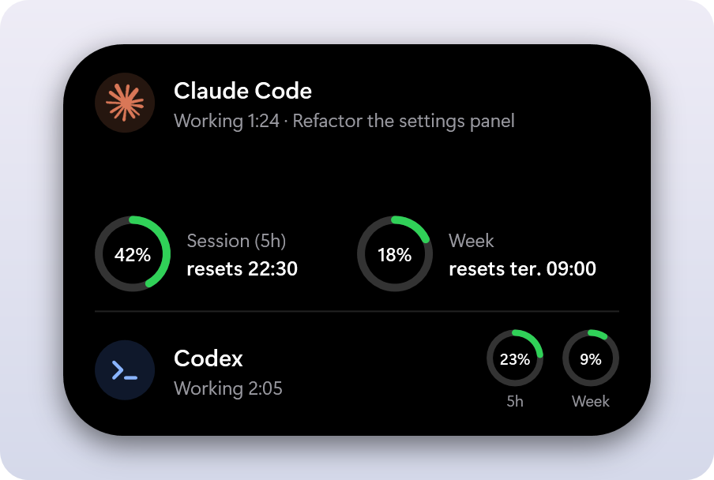 |
| Claude te necesita (un permiso o una pregunta) | 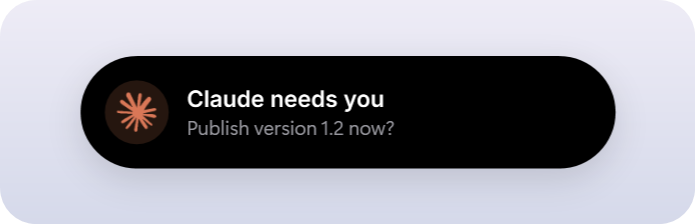 |
| Claude Code pide un permiso | 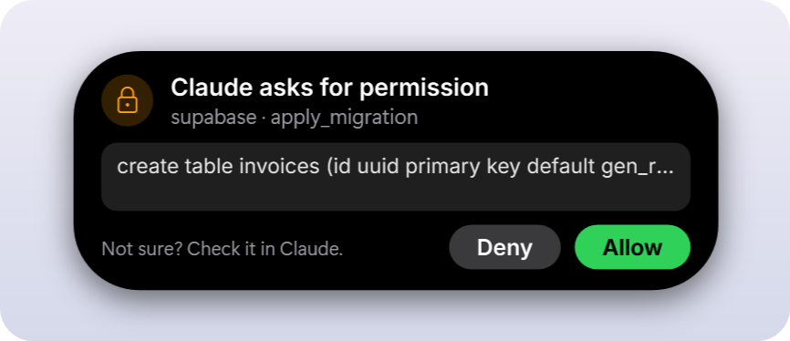 |
| Límite de Claude al 75% o 90% | 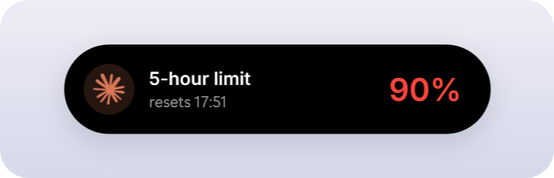 |
| Límite de Claude alcanzado | 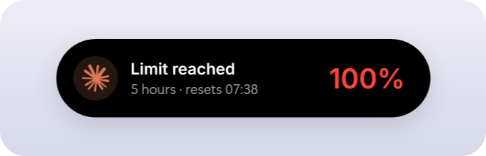 |
| Límite de Claude renovado | 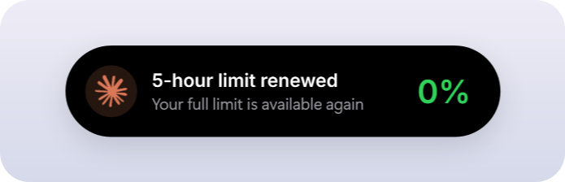 |
| Varios chats trabajando a la vez |  |
| Uno de dos chats te espera |  |
| La página de Claude lista cada chat | 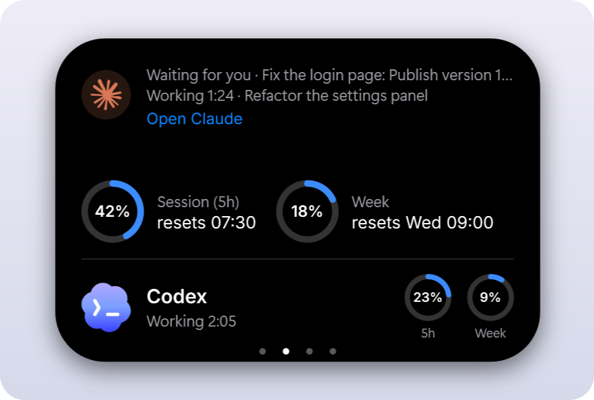 |
| Monitor del sistema: anillos, barras o números | 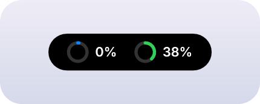 |
|  | 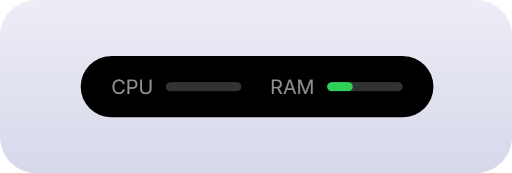 |
|  | 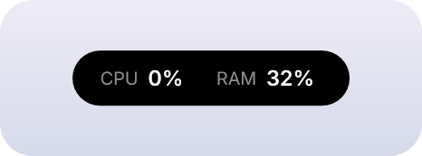 |
| Volumen o brillo cambiando | 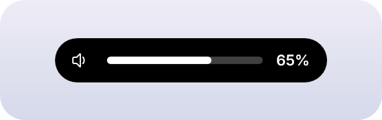 |

## Instalar

1. **Descarga** `WindowsIsland.exe` de la [última versión](https://github.com/leotrvs/windows-island/releases/latest). Windows puede mostrar un aviso de SmartScreen porque la app no tiene un certificado de firma de código de pago: elige **Más información** y luego **Ejecutar de todas formas**.
2. **Ábrelo** y elige **Sí**. Se instala solo para tu usuario de Windows, sin derechos de administrador, crea accesos directos en el menú Inicio y el Escritorio y se inicia con Windows.
3. La isla aparece en la parte superior de la pantalla, y su icono en la bandeja.

Para probarla sin instalar, ejecuta `WindowsIsland.exe --portable`.

## Uso

1. **Pasa el ratón** sobre la isla para expandirla, o **haz clic** en ella. Aparta el ratón y se contrae.
2. **Haz clic** en la barra de progreso para saltar a ese punto de la canción.
3. **Haz clic** en un aviso o notificación para descartarlo.
4. **Haz clic** en el icono de la bandeja, o abre el acceso directo de Windows Island mientras se ejecuta, para abrir **Settings**. Haz clic derecho en el icono para las acciones rápidas y **Salir**. Haz clic de nuevo en el icono de la bandeja para cerrar Settings.

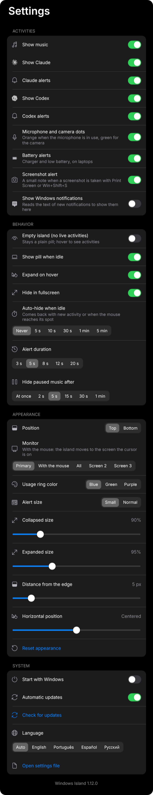

| Opción | Qué hace |
|---|---|
| Show music | Muestra lo que está sonando |
| Show Claude | Muestra la actividad y los límites de Claude Code |
| Claude alerts | Expande la isla cuando Claude termina o te necesita |
| Show Codex, Codex alerts | Actividad y límites de Codex, y el aviso cuando termina. Solo aparecen mientras Codex está trabajando |
| Microphone and camera dots | Muestra un punto junto a la isla mientras una app usa el micrófono (naranja) o la cámara (verde) |
| Battery alerts | Cargador conectado o retirado, batería baja y carga completa. Solo en portátiles |
| Show Windows notifications | Muestra las notificaciones nuevas en la isla. Desactivado por defecto |
| Alert size | Avisos y notificaciones pequeños o normales |
| Screenshot alert | Una nota muy pequeña cuando haces una captura con Impr Pant o Win+Mayús+S |
| Usage ring color | Azul, verde o morado. Los anillos pasan a ámbar y rojo cerca del límite |
| Language | Sigue a Windows por defecto. Inglés, portugués, español y ruso |
| Empty island | Mantiene la isla contraída como una píldora simple, sin actividades. Pasa el ratón o haz clic para verlas |
| Show pill when idle | Mantiene la píldora en pantalla cuando no pasa nada |
| Expand on hover | Expande al dejar el ratón sobre la isla. Si está desactivado, haz clic |
| Hide in fullscreen | Oculta la isla en juegos, vídeos y presentaciones |
| Position | Parte superior de la pantalla, o justo encima de la barra de tareas |
| Monitor | El principal, uno concreto, todos o el que tiene el ratón |
| Collapsed size, Expanded size | De 80% a 130%, por separado para cada estado |
| Distance from the edge, Horizontal position | Aleja la isla del borde o la mueve hacia un lado |
| Auto-hide when idle | Oculta la isla cuando lleva un rato sin mostrar nada. Vuelve con una actividad nueva o al llevar el ratón a su lugar |
| Alert duration | Cuánto tiempo quedan en pantalla los avisos de Claude y las notificaciones |
| Hide paused music after | Cuánto tiempo queda en la isla una canción en pausa |
| Start with Windows | Abre la app al iniciar sesión en Windows |
| Open settings file | Abre `settings.json`, donde `OffsetY` define la distancia al borde |

La app está en inglés y portugués, por eso las opciones aparecen en inglés.

## Cómo se leen los datos

- **Actividad de Claude:** Claude Code guarda un archivo pequeño por cada sesión abierta en `~/.claude/sessions`. La isla lee solo su tipo, el ID del proceso, el estado, el nombre y la hora del estado. Funciona con la terminal y con la app de escritorio. La app de escritorio mantiene un chat como ocupado mientras pide un permiso, así que la isla también lee la transcripción del chat, solo nombres de herramientas y horas y nunca lo que se dijo, para saber que una herramienta espera tu respuesta.
- **Límites de Claude:** cada 2 minutos, y al abrir el panel de Claude, la isla ejecuta `claude -p /usage` en segundo plano, los mismos números que ves en Claude Code. No llama al modelo ni gasta tokens. Si [Claude Usage Taskbar](https://github.com/leotrvs/claude-usage-taskbar) está instalado y tiene números más recientes, la isla usa esos.
- **Codex:** Codex guarda cada sesión como un archivo en `~/.codex/sessions`. Cada 2 segundos la isla lee el final del más reciente y toma solo si la última tarea empezó o terminó y los porcentajes de límite que Codex registró. Se actualizan cada vez que usas Codex. Nunca lee el inicio de sesión de Codex.
- **Notificaciones:** la API oficial de Windows para leer notificaciones necesita un paquete firmado, así que la isla lee, solo lectura, la base de datos local donde Windows las guarda. Muestra solo las notificaciones que llegan mientras está abierta y no guarda nada. Windows sigue mostrando su propio aviso: desactiva los avisos de notificación de una app en la Configuración de Windows si solo quieres la isla.
- **Iconos de sitios:** con la extensión del navegador instalada y una pestaña que reproduce sonido, la isla descarga una vez el `apple-touch-icon.png` público del sitio (solo HTTPS, sin redirecciones, un PNG pequeño) para mostrar un icono nítido. El sitio ve una petición normal desde tu dirección IP. Las notificaciones de sitios de Chrome o Edge traen el icono del sitio como un archivo que el propio navegador guarda en su carpeta `Notification Resources`; la isla lee solo ese archivo.

Los detalles están en [SECURITY.md](SECURITY.md).

## Actualizaciones

Cada hora la isla revisa la última versión en GitHub. Solo instala una actualización si su firma digital coincide con la clave incluida en la app y el hash del archivo coincide con la lista firmada, así que un archivo manipulado se rechaza. Se reinicia en la versión nueva cuando no estás usando la isla y muestra un aviso breve. Desactívalo con **Automatic updates** en el menú de la bandeja, donde **Check for updates** busca una actualización al momento.

## Desinstalar

Ve a **Configuración de Windows > Aplicaciones > Aplicaciones instaladas > Windows Island > Desinstalar**. Esto elimina la app, los accesos directos y la configuración.

## Compilar desde el código

Necesitas Windows 10 versión 2004 o posterior, o Windows 11, y el [SDK de .NET 10](https://dotnet.microsoft.com/download/dotnet/10.0). El exe generado funciona sin tener .NET instalado.

```powershell
git clone https://github.com/leotrvs/windows-island.git
cd windows-island
pwsh -File scripts/build.ps1
.\bin\WindowsIsland.exe
```

Si quieres contribuir, lee [CONTRIBUTING.md](CONTRIBUTING.md).

## Próximos pasos

La lista completa de lo planeado está en [docs/ROADMAP.md](docs/ROADMAP.md).

## Licencia

[MIT](LICENSE). El nombre y el logo de Claude no están cubiertos.

La fuente Inter va incluida bajo la SIL Open Font License, ver [src/Assets/fonts/NOTICE.md](src/Assets/fonts/NOTICE.md).
