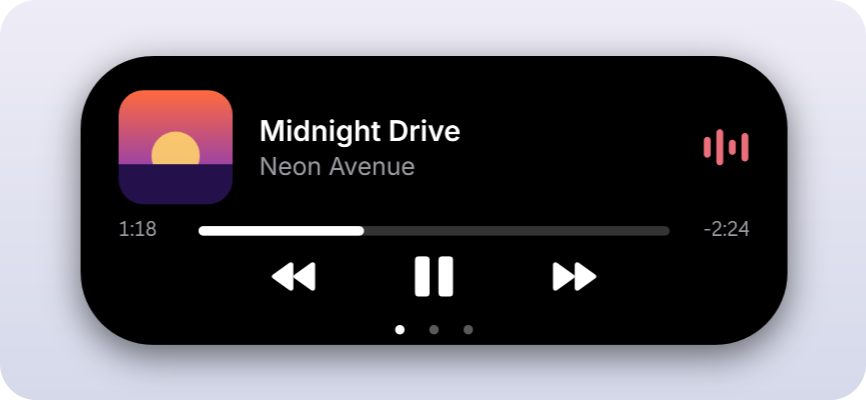

# Windows Island

[English](README.md) | [Português (Brasil)](README.pt-BR.md) | **Español** | [Русский](README.ru.md)

Una Dynamic Island para Windows. La música, Claude Code, sus límites de uso y tus notificaciones viven en una pequeña píldora en la parte superior de la pantalla, con el aspecto del iPhone y animaciones de resorte.

<p align="center">

</p>

> Proyecto no oficial de la comunidad. No está afiliado, respaldado ni mantenido por Apple ni por Anthropic. "Claude" y el logo de Claude pertenecen a Anthropic; la licencia MIT no los cubre.

[](https://github.com/leotrvs/windows-island/releases/latest/download/WindowsIsland.exe)

## Funciones

- **Música** de cualquier reproductor que aparezca en los controles multimedia de Windows, como Spotify o un navegador: carátula, un ecualizador con el color de la carátula, una barra de progreso en la que puedes hacer clic para avanzar, y reproducir, pausar, siguiente y anterior
- **Actividad en vivo de Claude Code:** el símbolo de Claude "piensa" mientras Claude trabaja, con el tiempo transcurrido, y late cuando te está esperando
- **Uso de Claude:** anillos para los límites de **5 horas** y **semanal**, con la hora en que se renuevan
- **Avisos** cuando Claude termina una tarea o te necesita
- **Notificaciones de Windows** en la isla, si las activas
- **Dos actividades a la vez:** la segunda se separa en una burbuja junto a la isla
- **Movimiento fluido:** la forma y el contenido cambian con resortes, nunca con transiciones de duración fija
- **Discreta:** nunca toma el foco, los clics a su alrededor llegan a la ventana de abajo, se reduce a una línea fina cuando hay una ventana maximizada delante y se oculta en pantalla completa
- **Ligera:** unos 40 MB de memoria y menos del 1% de CPU con música sonando
- Se instala solo para tu usuario, con accesos directos en el menú Inicio y el Escritorio e inicio con Windows
- Inglés y portugués de Brasil
- Actualizaciones automáticas firmadas
- **Nunca lee tu inicio de sesión ni tu token de Claude**. Su única conexión es buscar actualizaciones en este repositorio

## Estados

| Estado | Aspecto |
|---|---|
| En reposo |  |
| Música sonando, con Claude trabajando al lado |  |
| Claude trabajando, con el tiempo transcurrido |  |
| Claude terminó o te necesita |  |
| Una notificación de Windows |  |
| Claude expandido, con los límites |  |

## Instalar

1. **Descarga** `WindowsIsland.exe` de la [última versión](https://github.com/leotrvs/windows-island/releases/latest). Windows puede mostrar un aviso de SmartScreen porque la app no tiene un certificado de firma de código de pago: elige **Más información** y luego **Ejecutar de todas formas**.
2. **Ábrelo** y elige **Sí**. Se instala solo para tu usuario de Windows, sin derechos de administrador, crea accesos directos en el menú Inicio y el Escritorio y se inicia con Windows.
3. La isla aparece en la parte superior de la pantalla, y su icono en la bandeja.

Para probarla sin instalar, ejecuta `WindowsIsland.exe --portable`.

## Uso

1. **Pasa el ratón** sobre la isla para expandirla, o **haz clic** en ella. Aparta el ratón y se contrae.
2. **Haz clic** en la barra de progreso para saltar a ese punto de la canción.
3. **Haz clic** en un aviso o notificación para descartarlo.
4. **Haz clic derecho** en el icono de la bandeja para ver las opciones y **Salir**.

| Opción | Qué hace |
|---|---|
| Show music | Muestra lo que está sonando |
| Show Claude | Muestra la actividad y los límites de Claude Code |
| Claude alerts | Expande la isla cuando Claude termina o te necesita |
| Show Windows notifications | Muestra las notificaciones nuevas en la isla. Desactivado por defecto |
| Empty island | Mantiene la isla contraída como una píldora simple, sin actividades. Pasa el ratón o haz clic para verlas |
| Show pill when idle | Mantiene la píldora en pantalla cuando no pasa nada |
| Expand on hover | Expande al dejar el ratón sobre la isla. Si está desactivado, haz clic |
| Hide in fullscreen | Oculta la isla en juegos, vídeos y presentaciones |
| Position | Parte superior de la pantalla, o justo encima de la barra de tareas |
| Start with Windows | Abre la app al iniciar sesión en Windows |
| Open settings file | Abre `settings.json`, donde `OffsetY` define la distancia al borde |

La app está en inglés y portugués, por eso las opciones aparecen en inglés.

## Cómo se leen los datos

- **Actividad de Claude:** Claude Code guarda un archivo pequeño por cada sesión abierta en `~/.claude/sessions`. La isla lee solo su tipo, el ID del proceso, el estado, el nombre y la hora del estado. Funciona con la terminal y con la app de escritorio.
- **Límites de Claude:** cada 2 minutos, y al abrir el panel de Claude, la isla ejecuta `claude -p /usage` en segundo plano, los mismos números que ves en Claude Code. No llama al modelo ni gasta tokens. Si [Claude Usage Taskbar](https://github.com/leotrvs/claude-usage-taskbar) está instalado y tiene números más recientes, la isla usa esos.
- **Notificaciones:** la API oficial de Windows para leer notificaciones necesita un paquete firmado, así que la isla lee, solo lectura, la base de datos local donde Windows las guarda. Muestra solo las notificaciones que llegan mientras está abierta y no guarda nada. Windows sigue mostrando su propio aviso: desactiva los avisos de notificación de una app en la Configuración de Windows si solo quieres la isla.

Los detalles están en [SECURITY.md](SECURITY.md).

## Actualizaciones

Cada hora la isla revisa la última versión en GitHub. Solo instala una actualización si su firma digital coincide con la clave incluida en la app y el hash del archivo coincide con la lista firmada, así que un archivo manipulado se rechaza. Se reinicia en la versión nueva cuando no estás usando la isla y muestra un aviso breve. Desactívalo con **Automatic updates** en el menú de la bandeja, donde **Check for updates** busca una actualización al momento.

## Desinstalar

Ve a **Configuración de Windows > Aplicaciones > Aplicaciones instaladas > Windows Island > Desinstalar**. Esto elimina la app, los accesos directos y la configuración.

## Compilar desde el código

Necesitas Windows 10 versión 2004 o posterior, o Windows 11, y el [SDK de .NET 10](https://dotnet.microsoft.com/download/dotnet/10.0). El exe generado funciona sin tener .NET instalado.

```powershell
git clone https://github.com/leotrvs/windows-island.git
cd windows-island
pwsh -File scripts/build.ps1
.\bin\WindowsIsland.exe
```

Si quieres contribuir, lee [CONTRIBUTING.md](CONTRIBUTING.md).

## Próximos pasos

Planeado: ocultarse sola y cuánto tiempo queda abierta, ajustes de tamaño, posición y monitor, y el uso de Codex. La lista completa está en [docs/ROADMAP.md](docs/ROADMAP.md).

## Licencia

[MIT](LICENSE). El nombre y el logo de Claude no están cubiertos.
