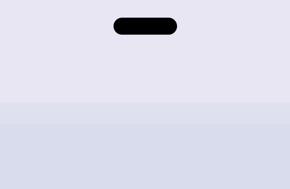
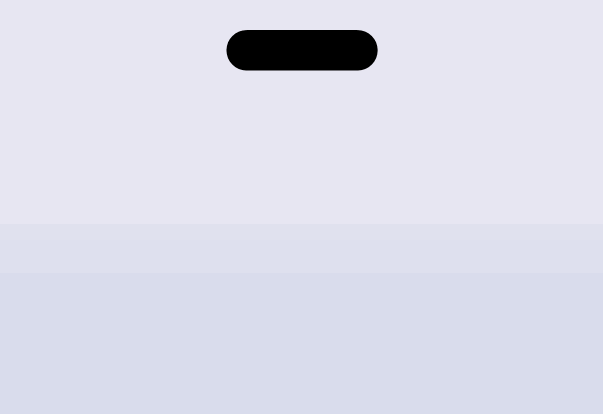
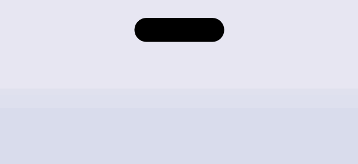
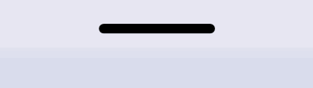
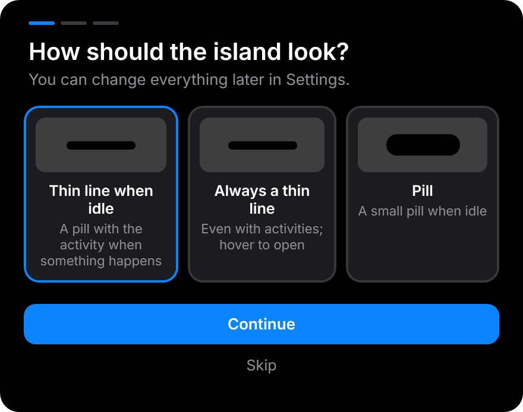
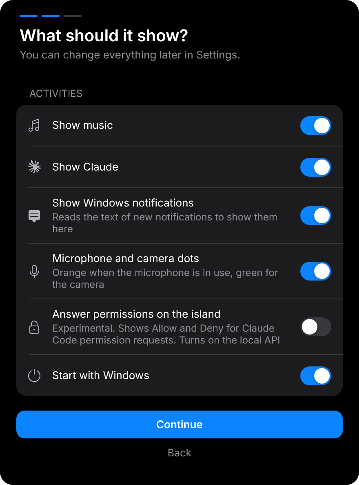
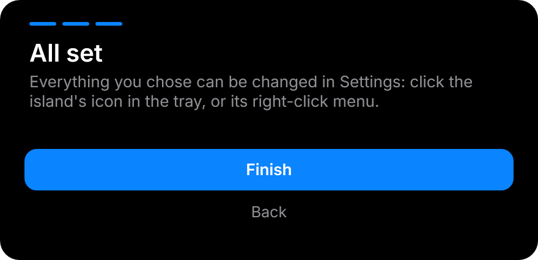
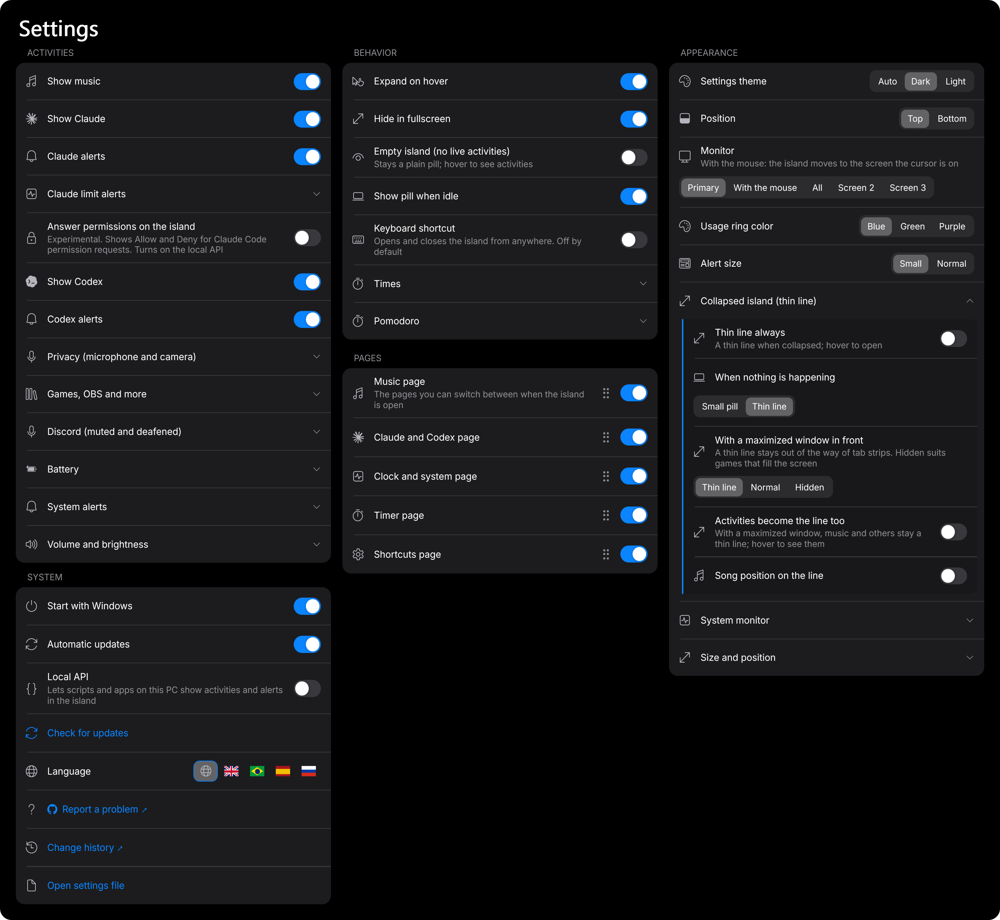

# Windows Island

**English** | [Português (Brasil)](README.pt-BR.md) | [Español](README.es.md) | [Русский](README.ru.md)

A Dynamic Island for Windows. Music, Claude Code, its usage limits and your notifications live in a small pill at the top of your screen, with iPhone-style looks and spring animations.

<p align="center">

</p>

<p align="center">
<a href="https://github.com/leotrvs/windows-island/releases/latest/download/WindowsIsland.exe"></a>
</p>

> Unofficial community project. It is not affiliated with, endorsed by, or supported by Apple, Anthropic or OpenAI. "Claude" and the Claude logo belong to Anthropic, and "Codex" to OpenAI; the MIT license does not cover them.

## Features

<table>
<tr>
<td width="33%" valign="top"><b>Music</b><br>Artwork, an equalizer in the cover's colors, a seek bar and the controls, from any player</td>
<td width="33%" valign="top"><b>Claude and Codex</b><br>Live activity, usage limits, alerts, and permissions answered right on the island</td>
<td width="33%" valign="top"><b>Live activities</b><br>Steam and browser downloads, OBS and Game Bar recording, Windows updates, the score of your team, timers</td>
</tr>
<tr>
<td width="33%" valign="top"><b>A thin line</b><br>Collapsed, the island is a thin line that shows what matters most; hover to open it</td>
<td width="33%" valign="top"><b>Privacy</b><br>Dots for the microphone, camera, screen sharing and recording, with the name of the app</td>
<td width="33%" valign="top"><b>Yours to adjust</b><br>Essentials and Advanced settings, a welcome on the first run, four languages, light or dark Settings</td>
</tr>
</table>

<details>
<summary><b>All features</b></summary>

- **Music** from any player in the Windows media controls, such as Spotify or a browser: artwork, an equalizer tinted by the artwork, a progress bar you can click to seek, and play, pause, next and previous
- **Claude Code live activity:** the Claude spark thinks while Claude works, with the time so far, and breathes when Claude is waiting for you
- **Claude usage:** rings for the **5-hour** and **weekly** limits, with reset times
- **Codex:** a live activity while Codex works, its 5-hour and weekly limits, and an alert when it finishes
- **Pages:** when the island is expanded, scroll over it or click the dots to switch between music, Claude and the timer, which also has its own buttons there
- **Timer, stopwatch and Pomodoro** (focus and break cycles): start one from the island's Timer page; it shows as a live activity and alerts you when the time is up
- **Microphone and camera dots:** orange while the microphone is in use, green for the camera, like on iPhone
- **Battery** on laptops: shown as an activity while charging, plus alerts for charger connected or removed, low battery and fully charged
- **App names on the dots:** see which app is using the microphone or camera
- **Screen sharing dot:** a blue dot while an app shares or records the screen, such as a call or a recording
- **Steam downloads (on by default):** the progress of a game being downloaded or updated in Steam, read from the manifest files Steam keeps beside the games
- **More live activities:** OBS recording, Windows updates, browser downloads (with the extension) and the live score of your team (off by default), plus a richer thin line that shows a tiny icon of what matters most
- **Discord muted or deafened (experimental, off by default):** a crossed microphone or crossed headphones beside the island while you are muted in Discord, however you muted. Needs a Discord app of your own, see [docs/DISCORD.md](docs/DISCORD.md)
- **Light or dark Settings:** the Settings window can follow the Windows theme or be set to light or dark; the island itself is always black
- **Your order and your times:** drag the pages into the order you like, which limit alerts to show (75%, 90%, 100%, renewed) and how long alerts, notifications and limit alerts stay
- **Volume and brightness** bar, **Bluetooth, USB and network** notes, and a moon for **Do not disturb**
- **Clock and system page** with the time, date, processor and memory load
- **System monitor** (off by default): keeps the processor and memory load on the island when nothing else is happening, as rings, bars or numbers
- **Tuck away:** drag the island up to put it away and use what is behind it; it comes back with new activity or when the mouse rests on its spot
- **Local API and command line** (off by default) so your scripts and apps can show their own activities and alerts, see [docs/API.md](docs/API.md), plus a small [browser extension](extension/README.md) that gives web audio the site's icon
- **Keyboard shortcut** to open and close the island (off by default, configurable)
- **Alerts** when Claude finishes a task or needs you
- **Limit alerts:** a note when the Claude 5-hour or weekly limit reaches 75%, 90% and 100%, and when it renews
- **Windows notifications** in the island, with the sending app's icon (on by default, asked in the welcome; you can turn them off)
- **Two activities at once:** the second one splits off into a bubble beside the island
- **Several Claude chats at once:** the island counts them (for example `2 · 0:58`, or `1/2 · Waiting` when one of two waits for you) and the Claude page lists each chat with its own state and time
- **Claude Desktop permissions:** a chat in the Claude desktop app that asks for a permission or puts a question shows as waiting for you, like in the terminal The question (when it is short) is shown in the alert, with an **Open Claude** link on the Claude page that brings the app to the front to answer.
- **Answer permissions on the island (experimental, off by default):** when Claude Code is about to ask for a permission, such as reading a database or applying a migration, the island shows the tool and what it wants to do with **Allow** and **Deny**. It uses a hook that you turn on in Settings; if you do not click in time, Claude asks as usual
- **Website icons:** with the browser extension, web audio shows the site's own icon, and website notifications show the site's icon and name
- **Fluid motion:** shape and content morph with springs, never with fixed-time fades
- **The thin line is the default look:** a thin line that shows, on itself, what matters most: a glow while Claude works, a tiny equalizer for music, a fill for a timer, a download or the charge, a pulse when Claude waits for you or when you are recording, and two tiny rings for the processor and memory
- **Discreet:** it never takes focus, clicks around it reach the window below, it shrinks to a thin line when a maximized window is in front and it hides in fullscreen
- **Light:** about 40 MB of memory and under 1% CPU while music plays
- Installs for your user only, with Start menu and Desktop shortcuts and start with Windows
- English and Brazilian Portuguese
- Signed automatic updates
- **Never reads your Claude login or token**. Its only connections are checking this repository for updates and, if you use the browser extension, one small icon download per site and, only if you turn on **Football score**, the public scoreboard of ESPN

</details>

## States

| State | Look |
|---|---|
| Idle |  |
| Music playing, with Claude working beside it |  |
| Claude working, with the time so far |  |
| Codex working |  |
| Claude finished or needs you |  |
| A Windows notification |  |
| Battery charging |  |
| Battery low |  |
| Claude expanded, with the limits |  |
| Claude needs you (a permission or a question) |  |
| Claude Code asks for a permission |  |
| Claude limit at 75% or 90% |  |
| Claude limit reached |  |
| Claude limit renewed |  |
| Several chats working at once |  |
| One of two chats waiting for you |  |
| The Claude page lists each chat |  |
| System monitor: rings, bars or numbers |  |
|  |  |
|  |  |
| Volume: the speaker's waves grow with the level, and it is crossed out when muted |  |
| Brightness: a sun that lights up, its rays growing with the level |  |
| Pomodoro: focus and break cycles, with the time counting down |  |
| Pomodoro on the compact island |  |
| Shortcuts page: mute the microphone or the speakers, take a screenshot, sound settings and the volume |  |

### The thin line

The collapsed island is a thin line by default (Settings, Behavior, "Thin line always"). It shows only the state that matters most, drawn on the line itself; hover to open the island.

| State | Look |
|---|---|
| At rest |  |
| Claude working: a glow runs along it (yellow or red as the limit fills) |  |
| Claude waits for you: the line pulses |  |
| Music: a tiny equalizer in the color of the cover |  |
| Timer: the line empties as the time runs out |  |
| A download, a build or a Steam game: the line fills with the progress |  |
| Done: the line turns green |  |
| Charging: the line fills with the charge |  |
| Screen recording (OBS or Game Bar): a dim red line with a blinking dot |  |
| Low battery or an error: the line pulses red |  |
| No internet: a dashed red line that blinks |  |
| Focus: a small moon |  |
| System monitor: two tiny rings, processor and memory |  |
| Microphone and camera: dots inside the line |  |
| A second activity: a tiny bubble beside the line |  |
| A change of song: the cover, the name and a symbol |  |
| Volume on the thin line |  |
| Brightness on the thin line |  |

### First run and settings

The first time it runs (and the first time after updating to 4.0), a short welcome asks how the island should look (a thin line when idle, always a thin line, or a pill) and what it should show (music, Claude, Windows notifications, microphone and camera dots, Claude permissions, start with Windows). Settings has two modes: **Essentials**, a few switches, and **Advanced**, every setting in four tabs with a search box.

  

## Install

1. **Download** `WindowsIsland.exe` from the [latest release](https://github.com/leotrvs/windows-island/releases/latest). Windows may show a SmartScreen warning because the app has no paid code-signing certificate: choose **More info**, then **Run anyway**.
2. **Open it** and choose **Yes**. It installs for your Windows user only, with no administrator rights, adds Start menu and Desktop shortcuts and starts with Windows.
3. The island appears at the top of the screen, and its icon in the tray.

To try it without installing, run `WindowsIsland.exe --portable`.

## Use

1. **Hover** over the island to expand it, or **click** it. Move the mouse away and it collapses.
2. **Click** the progress bar to jump to that point of the song.
3. **Click** an alert or notification to dismiss it.
4. **Click** the tray icon, or open the Windows Island shortcut while it runs, to open **Settings**. Right-click the icon for a menu with the thin line, Do not disturb for the island (banners stay away; only what Claude asks still shows), the empty island, **Check for updates** and a red **Close**. Click the tray icon again to close Settings.



| Option | What it does |
|---|---|
| Show music | Shows what is playing |
| Show Claude | Shows Claude Code activity and limits |
| Claude alerts | Expands the island when Claude finishes or needs you |
| Show Codex, Codex alerts | Codex activity and limits, and the alert when it finishes. Only appear while Codex is working |
| Limit alerts | A note when the 5-hour or weekly Claude limit reaches 75%, 90% and 100%, and when it renews |
| Microphone and camera dots | Shows a small dot beside the island while an app uses the microphone (orange) or the camera (green) |
| Battery alerts | Charger connected or removed, low battery and fully charged. Laptops only |
| Show Windows notifications | Shows new notifications in the island. On by default |
| Alert size | Small or normal alerts and notifications |
| Screenshot alert | A very small note when a screenshot is taken with Print Screen or Win+Shift+S |
| Usage ring color | Blue, green or purple. The rings turn amber and red near the limit |
| Language | Follows Windows by default. English, Portuguese, Spanish and Russian |
| Empty island | Keeps the collapsed island a plain pill, with no live activities. Hover or click to see them |
| Show pill when idle | Keeps the small pill on screen when nothing is happening |
| Expand on hover | Expands when the mouse rests on the island. When off, click it |
| Hide in fullscreen | Hides the island during games, videos and presentations |
| Position | Top of the screen, or just above the taskbar |
| Monitor | The primary monitor, a specific one, all of them, or the one with the mouse |
| Collapsed size, expanded size | 80% to 130%, set apart for each state |
| Distance from the edge, horizontal position | Moves the island down from the edge or to the side |
| Auto-hide when idle | Hides the island after it has shown nothing for a while. It comes back with new activity, or when you move the mouse to its spot |
| Alert duration | How long Claude alerts and notifications stay on screen |
| Hide paused music after | How long a paused song stays on the island |
| Start with Windows | Opens the app when you sign in to Windows |
| Open settings file | Opens `settings.json`, where `OffsetY` sets the distance from the edge |

## How the data is read

- **Claude activity:** Claude Code keeps one small file per running session in `~/.claude/sessions`. The island reads only its kind, process ID, status, name and status time. It works with the terminal and with the desktop app. Claude Desktop keeps a chat marked busy while it asks you for a permission, so the island also reads the chat's transcript, only tool names and times and never what was said, to know that a tool is waiting for your answer.
- **Claude limits:** every 2 minutes, and when you open the Claude panel, the island runs `claude -p /usage` in the background, the same numbers you see in Claude Code. It makes no model call and spends no tokens. If [Claude Usage Taskbar](https://github.com/leotrvs/claude-usage-taskbar) is installed and has fresher numbers, the island uses those.
- **Codex:** Codex keeps each session as a file in `~/.codex/sessions`. Every 2 seconds the island reads the end of the newest one and takes only whether the last task started or finished and the limit percentages Codex recorded. They update whenever you use Codex. It never reads Codex's login.
- **Notifications:** the official Windows API for reading notifications needs a signed package, so the island reads, read-only, the local database where Windows keeps them. It shows only notifications that arrive while it runs and stores nothing. Windows still shows its own banner too: turn off **Show notification banners** for an app in Windows Settings if you only want the island.
- **Website icons:** with the browser extension installed and a tab playing sound, the island downloads that site's public `apple-touch-icon.png` once (HTTPS only, no redirects, a small PNG) to show a sharp icon. The site sees an ordinary request from your IP address. Website notifications from Chrome or Edge carry the site's icon as a file that the browser itself saves in its `Notification Resources` folder; the island reads only that file.

Details are in [SECURITY.md](SECURITY.md).

## Updates

The full history of changes is in [CHANGELOG.md](CHANGELOG.md) (English) and [CHANGELOG.pt-BR.md](CHANGELOG.pt-BR.md) (Portuguese).

Every hour the island checks the latest GitHub release. It installs an update only if its digital signature matches the key built into the app and the file's hash matches the signed list, so a tampered file is rejected. It restarts into the new version when you are not using the island and shows a short notice. Turn this off with **Automatic updates** in Settings. **Check for updates** in the tray menu looks in the background and, when there is a new version, the island asks you: tap it to download, verify and restart.

## Uninstall

Go to **Windows Settings > Apps > Installed apps > Windows Island > Uninstall**. This removes the app, the shortcuts and the settings.

## Build from source

You need Windows 10 version 2004 or later, or Windows 11, and the [.NET 10 SDK](https://dotnet.microsoft.com/download/dotnet/10.0). The exe it builds runs without .NET installed.

```powershell
git clone https://github.com/leotrvs/windows-island.git
cd windows-island
pwsh -File scripts/build.ps1
.\bin\WindowsIsland.exe
```

Contributors should read [CONTRIBUTING.md](CONTRIBUTING.md).

## Roadmap

The full list of what is planned is in [docs/ROADMAP.md](docs/ROADMAP.md).

## License

[MIT](LICENSE). The Claude name and logo are not covered.

The Inter font is bundled under the SIL Open Font License, see [src/Assets/fonts/NOTICE.md](src/Assets/fonts/NOTICE.md).
