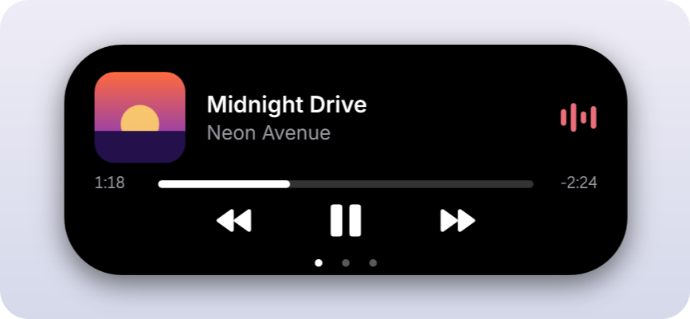
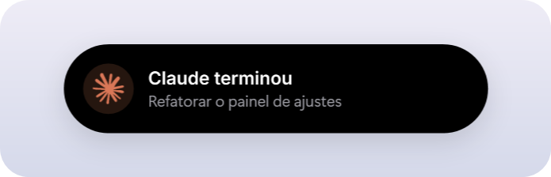
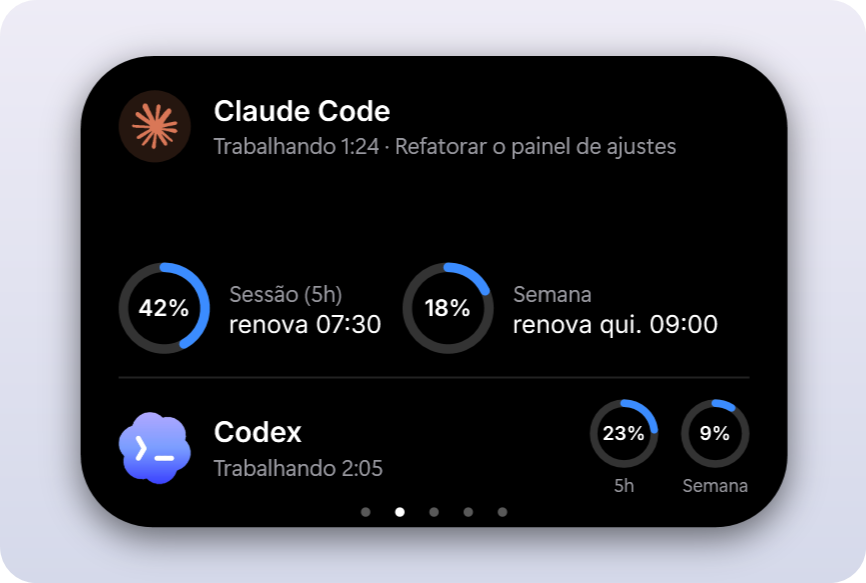
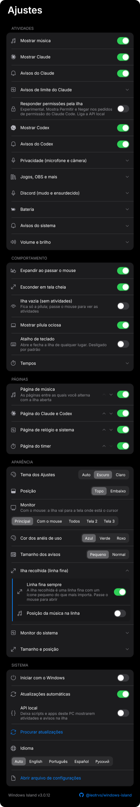

# Windows Island

[English](README.md) | **Português (Brasil)** | [Español](README.es.md) | [Русский](README.ru.md)

Uma Dynamic Island para o Windows. Música, Claude Code, os limites de uso e suas notificações ficam numa pequena pílula no topo da tela, com o visual do iPhone e animações de mola.

<p align="center">

</p>

> Projeto não oficial da comunidade. Não é afiliado, endossado ou mantido pela Apple, pela Anthropic ou pela OpenAI. "Claude" e o logo do Claude pertencem à Anthropic, e "Codex" à OpenAI; a licença MIT não os cobre.

[](https://github.com/leotrvs/windows-island/releases/latest/download/WindowsIsland.exe)

## Recursos

- **Música** de qualquer player que aparece nos controles de mídia do Windows, como Spotify ou um navegador: capa, equalizador na cor da capa, barra de progresso que avança ao clicar, e tocar, pausar, próxima e anterior
- **Atividade ao vivo do Claude Code:** o símbolo do Claude "pensa" enquanto ele trabalha, com o tempo decorrido, e pulsa quando ele está esperando você
- **Uso do Claude:** anéis dos limites de **5 horas** e **semanal**, com o horário em que renovam
- **Codex:** atividade ao vivo enquanto o Codex trabalha, os limites de 5 horas e semanal, e um aviso quando ele termina
- **Timer e cronômetro:** inicie um pelo menu da bandeja; ele aparece como atividade ao vivo e avisa quando o tempo acaba
- **Pontos de microfone e câmera:** laranja com o microfone em uso, verde com a câmera, como no iPhone
- **Avisos de bateria** em notebooks: carregador conectado ou removido, bateria baixa e carregada
- **Avisos** quando o Claude termina uma tarefa ou precisa de você
- **Notificações do Windows** na ilha, se você ligar
- **Duas atividades ao mesmo tempo:** a segunda se separa numa bolha ao lado da ilha
- **Movimento fluido:** forma e conteúdo mudam com molas, nunca com transições de tempo fixo
- **Discreta:** nunca rouba o foco, cliques ao redor chegam à janela de baixo, vira uma linha fina quando há uma janela maximizada na frente e some em tela cheia
- **Leve:** cerca de 40 MB de memória e menos de 1% de CPU com música tocando
- Instala só para o seu usuário, com atalhos no menu Iniciar e na Área de Trabalho e início com o Windows
- Inglês e português do Brasil
- Atualizações automáticas assinadas
- **Nunca lê seu login ou token do Claude**. A única conexão é a verificação de atualizações neste repositório

## Estados

| Estado | Visual |
|---|---|
| Ociosa |  |
| Música tocando, com o Claude trabalhando ao lado |  |
| Claude trabalhando, com o tempo decorrido |  |
| Codex trabalhando |  |
| Claude terminou ou precisa de você |  |
| Uma notificação do Windows |  |
| Claude expandido, com os limites |  |

## Instalar

1. **Baixe** o `WindowsIsland.exe` da [última release](https://github.com/leotrvs/windows-island/releases/latest). O Windows pode mostrar um aviso do SmartScreen porque o app não tem certificado pago de assinatura de código: escolha **Mais informações** e depois **Executar assim mesmo**.
2. **Abra o arquivo** e escolha **Sim**. Ele instala só para o seu usuário do Windows, sem direitos de administrador, cria atalhos no menu Iniciar e na Área de Trabalho e inicia com o Windows.
3. A ilha aparece no topo da tela, e o ícone dela na bandeja.

Para testar sem instalar, rode `WindowsIsland.exe --portable`.

## Uso

1. **Passe o mouse** sobre a ilha para expandir, ou **clique** nela. Tire o mouse e ela recolhe.
2. **Clique** na barra de progresso para ir até aquele ponto da música.
3. **Clique** num aviso ou notificação para dispensar.
4. **Clique** no ícone da bandeja, ou abra o atalho do Windows Island com ele rodando, para abrir os **Ajustes**. Clique com o botão direito no ícone para as ações rápidas e **Sair**.



| Opção | O que faz |
|---|---|
| Mostrar música | Mostra o que está tocando |
| Mostrar Claude | Mostra a atividade e os limites do Claude Code |
| Avisos do Claude | Expande a ilha quando o Claude termina ou precisa de você |
| Mostrar Codex, Avisos do Codex | Atividade e limites do Codex, e o aviso quando ele termina. Só aparecem com o Codex instalado |
| Pontos de microfone e câmera | Mostra um pontinho ao lado da ilha enquanto um app usa o microfone (laranja) ou a câmera (verde) |
| Avisos de bateria | Carregador conectado ou removido, bateria baixa e carregada. Só em notebooks |
| Mostrar notificações do Windows | Mostra as notificações novas na ilha. Vem desligado |
| Ilha vazia | Mantém a ilha recolhida como uma pílula simples, sem atividades. Passe o mouse ou clique para vê-las |
| Mostrar pílula ociosa | Mantém a pílula na tela quando nada está acontecendo |
| Expandir ao passar o mouse | Expande quando o mouse para sobre a ilha. Desligado, é preciso clicar |
| Esconder em tela cheia | Esconde a ilha em jogos, vídeos e apresentações |
| Posição | Topo da tela, ou logo acima da barra de tarefas |
| Monitor | O principal, um específico, todos, ou o que está com o mouse |
| Tamanho recolhida, tamanho expandida | De 80% a 130%, separado para cada estado |
| Distância da borda, posição horizontal | Afasta a ilha da borda ou move para o lado |
| Esconder sozinha quando ociosa | Esconde a ilha depois de um tempo sem mostrar nada. Ela volta com uma atividade nova ou quando você leva o mouse até o lugar dela |
| Duração dos avisos | Quanto tempo os avisos do Claude e as notificações ficam na tela |
| Esconder música pausada após | Quanto tempo uma música pausada fica na ilha |
| Iniciar com o Windows | Abre o app quando você entra no Windows |
| Abrir arquivo de configurações | Abre o `settings.json`, onde `OffsetY` define a distância da borda |

## Como os dados são lidos

- **Atividade do Claude:** o Claude Code mantém um arquivo pequeno por sessão aberta em `~/.claude/sessions`. A ilha lê apenas o tipo, o ID do processo, o status, o nome e o horário do status. Funciona com o terminal e com o app de desktop.
- **Limites do Claude:** a cada 2 minutos, e quando você abre o painel do Claude, a ilha roda `claude -p /usage` em segundo plano, os mesmos números que você vê no Claude Code. Não chama o modelo e não gasta tokens. Se o [Claude Usage Taskbar](https://github.com/leotrvs/claude-usage-taskbar) estiver instalado e tiver números mais recentes, a ilha usa esses.
- **Codex:** o Codex guarda cada sessão como um arquivo em `~/.codex/sessions`. A cada 2 segundos a ilha lê o final do mais recente e pega só se a última tarefa começou ou terminou e as porcentagens de limite que o Codex registrou. Elas se atualizam sempre que você usa o Codex. O login do Codex nunca é lido.
- **Notificações:** a API oficial do Windows para ler notificações exige um pacote assinado, então a ilha lê, somente leitura, o banco local onde o Windows as guarda. Mostra só as notificações que chegam enquanto ela está aberta e não guarda nada. O Windows continua mostrando o próprio aviso: desligue **Mostrar faixas de notificação** de um app nas Configurações do Windows se quiser só a ilha.

Detalhes em [SECURITY.md](docs/SECURITY.pt-BR.md).

## Atualizações

A cada hora a ilha confere a última release do GitHub. Ela só instala uma atualização se a assinatura digital bater com a chave embutida no app e o hash do arquivo bater com a lista assinada, então um arquivo adulterado é recusado. Ela reinicia na versão nova quando você não está usando a ilha e mostra um aviso rápido. Desligue em **Atualizações automáticas** no menu da bandeja, onde **Procurar atualizações** faz uma verificação na hora.

## Desinstalar

Vá em **Configurações do Windows > Aplicativos > Aplicativos instalados > Windows Island > Desinstalar**. Isso remove o app, os atalhos e as configurações.

## Compilar a partir do código

Você precisa do Windows 10 versão 2004 ou mais recente, ou do Windows 11, e do [SDK do .NET 10](https://dotnet.microsoft.com/download/dotnet/10.0). O exe gerado roda sem o .NET instalado.

```powershell
git clone https://github.com/leotrvs/windows-island.git
cd windows-island
pwsh -File scripts/build.ps1
.\bin\WindowsIsland.exe
```

Para contribuir, leia o [CONTRIBUTING.md](CONTRIBUTING.md).

## Próximos passos

Planejado: download menor e mais atividades ao vivo. A lista completa está em [docs/ROADMAP.md](docs/ROADMAP.md).

## Licença

[MIT](LICENSE). O nome e o logo do Claude não estão cobertos.
