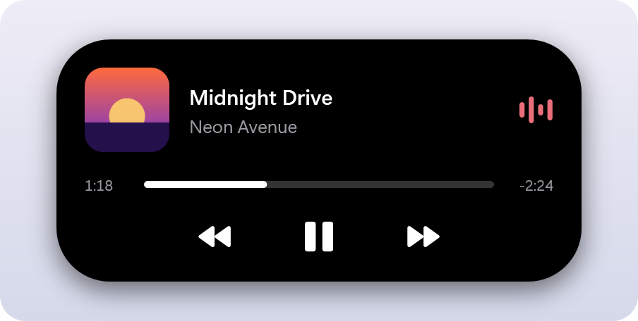
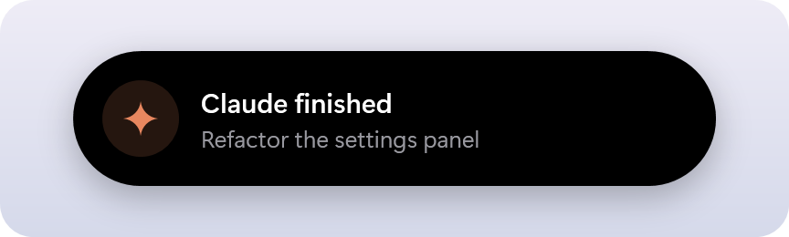
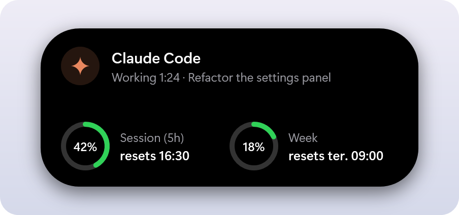

# Windows Island

[English](README.md) | [Português (Brasil)](README.pt-BR.md) | [Español](README.es.md) | **Русский**

Dynamic Island для Windows. Музыка, Claude Code и его лимиты использования живут в маленькой капсуле в верхней части экрана — в стиле iPhone и с пружинными анимациями.

<p align="center">

</p>

> Неофициальный проект сообщества. Он не связан с Apple или Anthropic, не одобрен и не поддерживается ими. «Claude» — товарный знак Anthropic.

> **Ранняя версия.** Установщика пока нет. Чтобы попробовать, [соберите из исходников](#сборка-из-исходников).

## Возможности

- **Музыка** из любого плеера, который отображается в медиаэлементах Windows, например Spotify или браузер: обложка, эквалайзер в цвет обложки, полоса прогресса с перемоткой по клику, а также воспроизведение, пауза, следующий и предыдущий трек
- **Активность Claude Code в реальном времени:** сколько Claude уже работает и когда он ждёт вас
- **Использование Claude:** кольца для **5-часового** и **недельного** лимитов со временем сброса
- **Уведомления**, когда Claude закончил задачу или ему нужны вы
- **Две активности сразу:** вторая отделяется в пузырёк рядом с островом
- **Плавное движение:** форма и содержимое меняются по законам пружины, а не за фиксированное время
- **Ненавязчивость:** остров никогда не забирает фокус, клики вокруг него проходят в окно под ним, при развёрнутом окне он сжимается в тонкую линию, а в полноэкранном режиме скрывается
- Положение сверху или снизу, запуск вместе с Windows, английский и бразильский португальский
- **Никогда не читает ваш логин или токен Claude** и не подключается к сети

## Состояния

| Состояние | Вид |
|---|---|
| Ожидание |  |
| Играет музыка, рядом работает Claude |  |
| Claude работает, с прошедшим временем |  |
| Claude закончил или ему нужны вы |  |
| Claude развёрнут, с лимитами |  |

## Использование

1. **Наведите** указатель на остров, чтобы развернуть его, или **щёлкните** по нему. Уберите указатель — и он свернётся.
2. **Щёлкните** по полосе прогресса, чтобы перейти к этому месту песни.
3. **Щёлкните правой кнопкой** по значку в трее, чтобы открыть настройки и **Quit**.

| Параметр | Что делает |
|---|---|
| Show music | Показывает, что сейчас играет |
| Show Claude | Показывает активность и лимиты Claude Code |
| Claude alerts | Разворачивает остров, когда Claude закончил или ему нужны вы |
| Show pill when idle | Оставляет капсулу на экране, когда ничего не происходит |
| Expand on hover | Разворачивает остров, когда на нём задерживается указатель. Если выключено, щёлкните |
| Hide in fullscreen | Скрывает остров в играх, видео и презентациях |
| Position | Верх экрана или прямо над панелью задач |
| Start with Windows | Запускает приложение при входе в Windows |
| Open settings file | Открывает `settings.json`, где `OffsetY` задаёт отступ от края |

Приложение доступно на английском и португальском, поэтому параметры показаны на английском.

## Как читаются данные Claude

- **Активность:** Claude Code хранит по небольшому файлу на каждую открытую сессию в `~/.claude/sessions`. Остров читает только тип, ID процесса, статус, название и время статуса. Работает и с терминалом, и с настольным приложением.
- **Лимиты:** остров читает проценты и время сброса, которые сохраняет [Claude Usage Taskbar](https://github.com/leotrvs/claude-usage-taskbar). Без него в области лимитов показывается подсказка, а всё остальное продолжает работать.

Подробности — в [SECURITY.md](SECURITY.md).

## Сборка из исходников

Нужна Windows 10 версии 2004 или новее либо Windows 11, а также [.NET 10 SDK](https://dotnet.microsoft.com/download/dotnet/10.0).

```powershell
git clone https://github.com/leotrvs/windows-island.git
cd windows-island
pwsh -File scripts/build.ps1
.\bin\WindowsIsland.exe
```

Если хотите помочь проекту, прочитайте [CONTRIBUTING.md](CONTRIBUTING.md).

## Планы

- Установщик и подписанные автоматические обновления
- Чтение лимитов самостоятельно, без Claude Usage Taskbar
- Уведомления Windows в острове
- Таймеры, батарея, а также используемые микрофон и камера
- Способ для скриптов и других приложений показывать свои активности в реальном времени
- Окно настроек, темы и несколько мониторов
- Меньшее потребление памяти

## Лицензия

[MIT](LICENSE)
